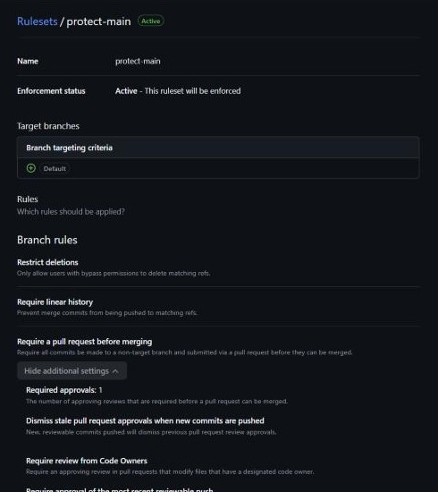
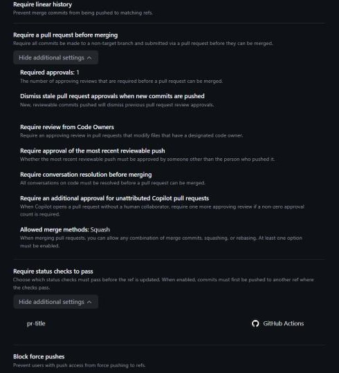

# team-devops-handbook

Командний технічний довідник курсу DevOps 2026: конвенції гілок і комітів, спільні налаштування
редактора, шаблон README для консольних утиліт і чек-лист рецензування. Предмет роботи —
текстові та конфігураційні файли, якими команда користуватиметься в наступних лабораторних.

## Склад команди

| Учасник | GitHub | Роль |
|---|---|---|
| Олександра Тищенко | [@tyshchenkooleksandra-hue](https://github.com/tyshchenkooleksandra-hue) | власниця репозиторію, автор і рецензент |
| Олександра Тищенко (другий акаунт) | [@AlexandraTyshchenko](https://github.com/AlexandraTyshchenko) | автор і рецензент |

> **Примітка.** Команда складається з однієї людини — за погодженням із викладачем. Другий акаунт
> належить тій самій авторці й потрібен через обмеження GitHub: автор pull request не може схвалити
> власний PR, а ruleset вимагає схвалення й забороняє обхід правил. Тому кожен PR одного акаунта
> рецензує й схвалює інший.

## Розділи та відповідальні

| Розділ | Файл | Відповідальна |
|---|---|---|
| Конвенції гілок і комітів | [`docs/branching.md`](docs/branching.md) | @tyshchenkooleksandra-hue |
| Спільні налаштування | [`docs/editor-config.md`](docs/editor-config.md) | @AlexandraTyshchenko |
| Шаблон README | [`docs/readme-template.md`](docs/readme-template.md) | @tyshchenkooleksandra-hue |
| Чек-лист рецензування | [`docs/code-review.md`](docs/code-review.md) | @AlexandraTyshchenko |
| Розбір конфлікту | [`docs/conflict.md`](docs/conflict.md) | @tyshchenkooleksandra-hue |

Рецензентів призначає [`CODEOWNERS`](.github/CODEOWNERS), а не пам'ять: GitHub сам запитує
рецензію власника файла, який змінює pull request.

## Правила репозиторію

Гілка `main` захищена ruleset-ом `protect-main`:

| Правило | Значення |
|---|---|
| Обов'язковий pull request | увімкнено |
| Кількість схвалень | 1 (у команді два акаунти) |
| Скидання застарілих схвалень при нових комітах | увімкнено |
| Обов'язкова рецензія від власників коду | увімкнено |
| Схвалення останнього пушу | увімкнено |
| Усі обговорення мають бути закриті | увімкнено |
| Заборона force-push і видалення гілки | увімкнено |
| Лінійна історія, злиття лише squash | увімкнено |
| Обов'язкова перевірка `pr-title` (формат заголовка PR) | увімкнено |
| Обхід правил (bypass list) | порожній — **адміністратор теж іде через PR** |

Заборону обходу видно через API — обійти правила не може ніхто, включно з власницею репозиторію:

```text
$ gh api repos/tyshchenkooleksandra-hue/team-devops-handbook/rulesets/26492456     --jq '"enforcement: "+.enforcement+", bypass_actors: "+(.bypass_actors|tostring)+", current_user_can_bypass: "+.current_user_can_bypass'
enforcement: active, bypass_actors: [], current_user_can_bypass: never
```

<p>
  
  
</p>

## Як працювати

1. Після клонування — один раз: `git config core.hooksPath .githooks` (хук формату коміту, див. [`docs/branching.md`](docs/branching.md)).
2. Гілка від свіжого `main`: `feature/<ім'я>-<тема>`.
3. Одна зміна — один pull request; опис за шаблоном.
4. Правки після рецензії — **окремим комітом** у ту саму гілку, без переписування історії.
5. Злиття — squash, повідомлення коміту — заголовок PR. Список змін генерується автоматично (див. [`docs/branching.md`](docs/branching.md#список-змін)).

## Як забрати довідник у свій репозиторій

Довідник — стартовий набір для наступних лабораторних. Забираємо його через `git subtree`:

```bash
# у своєму репозиторії (наприклад, devops-portfolio)
git remote add handbook https://github.com/tyshchenkooleksandra-hue/team-devops-handbook.git
git subtree add --prefix=handbook handbook main --squash

# пізніше — підтягнути оновлення довідника
git subtree pull --prefix=handbook handbook main --squash
```

| Спосіб | Що отримуємо | Чому не він / чому він |
|---|---|---|
| Скопіювати файли | звичайні файли | губиться зв'язок із джерелом: оновлення довідника доведеться переносити вручну |
| `git submodule` | посилання на інший репозиторій | файлів у репозиторії немає: без `--recurse-submodules` клон порожній, на GitHub видно лише посилання |
| **`git subtree`** | звичайні файли в теці `handbook/` + можливість `pull` оновлень | обрано: читач бачить файли одразу, клонувати нічого додатково не треба |
