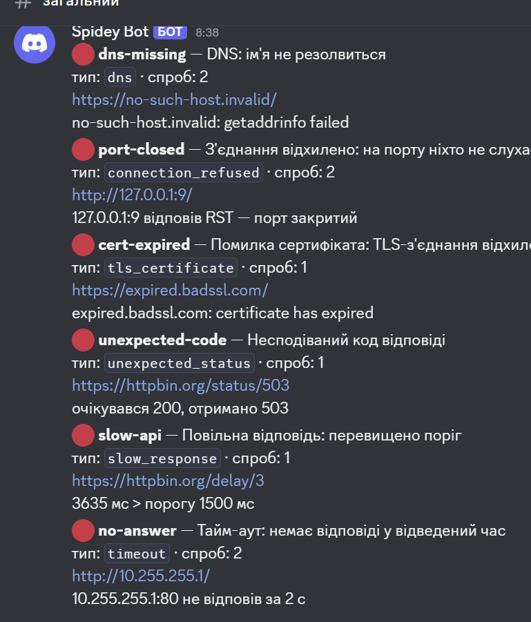

# Лабораторна робота 3 — Власний DevOps-інструментарій

| Інструмент | Що робить | Мова |
|---|---|---|
| [`backup.sh`](backup.sh) | стиснений архів теки з ротацією старих копій | bash |
| [`api_monitor.py`](api_monitor.py) | перевірка endpoint'ів із розрізненням 6 типів збою, сповіщення в Discord | Python 3, лише stdlib |
| [`hooks/`](hooks/) | `pre-commit` (лінтери на файлах коміту), `pre-push` (тести) | bash |
| [`monitor.sh`](monitor.sh) | бонус 1: CPU, пам'ять, диски, процеси з порогами; cron | bash, Linux |
| [`log_analyzer.py`](log_analyzer.py) | бонус 2: звіт за журналом веб-сервера (combined) | Python 3 |
| [`go/fsort`](go/fsort/) | бонус 3: розкладає файли за типами | Go |

Спільні вимоги виконано в кожному інструменті: `--help` з призначенням, усіма параметрами й
прикладом; різні коди виходу для різних причин; зрозумілі повідомлення замість трасування стека;
журнал у `logs/` (рядок на запуск: час, дія, результат); тести в [`tests/`](tests/).

## `set -euo pipefail` — що робить кожен прапорець

| Прапорець | Що робить | Що зламається без нього |
|---|---|---|
| `-e` | скрипт зупиняється на першій команді, що завершилась помилкою | `tar` упаде (немає місця на диску), а скрипт піде далі й **видалить старі архіви** в ротації — залишиться нуль робочих копій |
| `-u` | звернення до незаданої змінної — помилка, а не порожній рядок | одрук `rm -rf "$DEST_DIR/"*` замість `$DEST/` перетвориться на `rm -rf /*` |
| `-o pipefail` | код конвеєра = код першої команди, що впала, а не останньої | у `find … \| wc -l` помилка `find` (немає прав) ховається: `wc` поверне 0 і скрипт вважатиме, що все гаразд |

`-e` не всесильний: він не спрацьовує в умовах (`if cmd`, `cmd || …`) і в підстановках у
`local x=$(…)`. Тому важливі перевірки в скриптах — явні (`if ! tar …; then die …`).

---

## Завдання 1. `backup.sh`

```text
Використання: backup.sh --source <шлях> --dest <шлях> [--keep N] [--dry-run]
```

| Параметр | Обов'язковий | Призначення |
|---|---|---|
| `--source <шлях>` | так | тека, яку архівуємо |
| `--dest <шлях>` | так | куди складати архіви; створюється, якщо немає |
| `--keep <N>` | ні, типово 5 | скільки останніх копій зберігати |
| `--dry-run` | ні | показати всі дії, нічого не змінюючи |
| `--help` | — | довідка |

| Код | Причина |
|---|---|
| 0 | успіх |
| 1 | неправильні або відсутні параметри |
| 2 | джерело не існує або недоступне для читання |
| 3 | тека призначення недоступна |
| 4 | помилка архівування |
| 5 | помилка видалення старих копій |

**Рішення:**

- **Ім'я архіву** `<джерело>-РРРР-ММ-ДД-ГГХХСС.tar.gz`: мітка від старшого розряду до молодшого,
  тому сортування за іменем = сортування за часом. Якщо два запуски потрапили в одну секунду,
  скрипт чекає наступну — інакше другий архів перезаписав би перший.
- **Ротація рахує лише архіви цього джерела**: шаблон «ім'я + точний формат мітки»
  (`my project-[0-9]{4}-[0-9]{2}-…`). Файли `notes.txt`, `other-2026-…tar.gz` і навіть
  `my project-old.tar.gz` залишаються.
- **Атомарність**: архів пишеться у `*.part` і перейменовується лише після успіху `tar` —
  обірваний архів ніколи не виглядає як готовий і не бере участі в ротації.
- **Шляхи з пробілами**: усі змінні в лапках, глоб складається з літерального префікса в лапках.
- **Знайдена проблема на Windows:** GNU tar сприймає `C:\…` у `-f` як *віддалений хост*
  (синтаксис `host:path`) і падає з «Cannot connect to C: resolve failed». Тому архів пишеться в
  stdout і перенаправляється у файл (`tar -czf - … > "$TMP"`) — однаково працює скрізь.

**Перевірка** (усі сценарії автоматизовано в [`tests/test_backup.py`](tests/test_backup.py)):

```text
$ for i in 1 2 3 4 5 6; do ./backup.sh --source "my project" --dest "dest dir" --keep 3; done
...
залишено архівів my project: 3 (--keep 3)
$ ls "dest dir"
my project-2026-11-04-081112.tar.gz
my project-2026-11-04-081113.tar.gz
my project-2026-11-04-081114.tar.gz
my project-old.tar.gz            ← чуже, не зачеплено
notes.txt                        ← чуже, не зачеплено
other-2026-01-01-000000.tar.gz   ← чуже, не зачеплено

$ ./backup.sh --source nope --dest "dest dir"; echo $?
backup.sh: помилка: джерело не існує: nope
2

$ ./backup.sh --source "my project" --dest "dest dir" --keep 3 --dry-run   # після 5 запусків
[dry-run] створити архів: dest dir/my project-2026-11-04-081135.tar.gz (2 файлів із my project)
[dry-run] видалити старий архів: dest dir/my project-2026-11-04-081129.tar.gz
[dry-run] видалити старий архів: dest dir/my project-2026-11-04-081131.tar.gz
[dry-run] видалити старий архів: dest dir/my project-2026-11-04-081132.tar.gz
залишено архівів my project: 3 (--keep 3)
                                 ← архівів як було 5, так і лишилося 5
```

Журнал (`logs/backup.log`, шлях змінює `BACKUP_LOG`):

```text
2026-11-04T08:11:36+0200 action=backup result=ok source="…/my project" archive="…/my project-2026-11-04-081135.tar.gz" files=2 size_bytes=210 deleted=3 kept=3
2026-11-04T08:30:06+0200 action=backup result=failed code=2 reason="джерело не існує: …/nope"
```

---

## Завдання 2. `api_monitor.py`

Лише стандартна бібліотека: `socket`, `ssl`, `http.client` дають доступ до кожного етапу
запиту окремо — саме це потрібно, щоб розрізняти типи збою. Висока абстракція (`requests`)
звела б кілька різних збоїв до одного `ConnectionError`.

### Конфігурація

[`config/targets.json`](config/targets.json): `defaults` + список `targets`; значення цілі
перекривають типові.

```json
{
  "defaults": { "expected_status": 200, "timeout_s": 5, "slow_ms": 2000 },
  "targets": [
    { "name": "example-ok", "url": "https://example.com/" },
    { "name": "slow-api",   "url": "https://httpbin.org/delay/3", "timeout_s": 10, "slow_ms": 1500 }
  ]
}
```

| Поле | Значення |
|---|---|
| `name` | ім'я в журналі й сповіщенні (типово — хост) |
| `url` | адреса `http://` або `https://` |
| `expected_status` | очікуваний HTTP-код |
| `timeout_s` | тайм-аут з'єднання/читання, с |
| `slow_ms` | поріг «повільної відповіді», мс |

**Секрети не в коді й не в конфігурації**: адреса Discord-вебхука береться зі змінної
середовища `DISCORD_WEBHOOK_URL`. Без неї перевірка працює, сповіщення пропускаються з
попередженням у журналі.

```bash
export DISCORD_WEBHOOK_URL='https://discord.com/api/webhooks/…'   # PowerShell: $env:DISCORD_WEBHOOK_URL='…'
python api_monitor.py --config config/targets.json
```

### Типи збою — етап, на якому зупинився запит

| Тип (`failure_type`) | Етап | Як визначається | Повтор |
|---|---|---|---|
| `dns` | 1. ім'я → адреса | `socket.getaddrinfo` → `gaierror` | так |
| `connection_refused` | 2. TCP | сервер відповів RST → `ConnectionRefusedError` | так |
| `timeout` | 2–4 | немає відповіді за `timeout_s` → `TimeoutError` | так |
| `tls_certificate` | 3. TLS | `ssl.SSLCertVerificationError` + причина (`verify_message`) | ні |
| `unexpected_status` | 4. HTTP | код ≠ `expected_status` | ні |
| `slow_response` | 5. час | код правильний, але час > `slow_ms` | ні |

**Одна повторна спроба** — лише для мережевих збоїв: вони бувають тимчасовими. Прострочений
сертифікат чи 503 від повтору не зміняться; повтор лише затримав би сповіщення.

Коди виходу: `0` — усі цілі здорові, `1` — є проблемні, `2` — помилка параметрів/конфігурації.

### Перевірка: шість різних повідомлень

```text
$ SSL_CERT_FILE=/mingw64/etc/ssl/certs/ca-bundle.crt python api_monitor.py --no-notify; echo $?
2026-11-04T08:28:31+02:00 action=run targets=7 config=lab-03/config/targets.json
2026-11-04T08:28:31+02:00 target=example-ok status=OK http=200 response_ms=230
2026-11-04T08:28:32+02:00 target=dns-missing status=FAIL type=dns attempts=2 — DNS: ім'я не резолвиться: no-such-host.invalid: getaddrinfo failed
2026-11-04T08:28:37+02:00 target=port-closed status=FAIL type=connection_refused attempts=2 — З'єднання відхилено: на порту ніхто не слухає: 127.0.0.1:9 відповів RST — порт закритий
2026-11-04T08:28:38+02:00 target=cert-expired status=FAIL type=tls_certificate attempts=1 — Помилка сертифіката: TLS-з'єднання відхилено: expired.badssl.com: certificate has expired
2026-11-04T08:28:39+02:00 target=unexpected-code status=FAIL type=unexpected_status attempts=1 — Несподіваний код відповіді: очікувався 200, отримано 503
2026-11-04T08:28:42+02:00 target=slow-api status=FAIL type=slow_response attempts=1 — Повільна відповідь: перевищено поріг: 3547 мс > порогу 1500 мс
2026-11-04T08:28:47+02:00 target=no-answer status=FAIL type=timeout attempts=2 — Тайм-аут: немає відповіді у відведений час: 10.255.255.1:80 не відповів за 2 с
2026-11-04T08:28:47+02:00 action=summary result=problems healthy=1 failed=6
1
```

Сповіщення в Discord — окреме на кожну проблемну ціль, тип збою видно в заголовку й полі `тип`:

```text
сповіщення надіслано: dns-missing (dns)
сповіщення надіслано: port-closed (connection_refused)
сповіщення надіслано: cert-expired (tls_certificate)
сповіщення надіслано: unexpected-code (unexpected_status)
сповіщення надіслано: slow-api (slow_response)
сповіщення надіслано: no-answer (timeout)
```



Структурований результат — `logs/api_monitor.jsonl`, рядок на ціль:

```json
{"time": "2026-11-04T08:30:23+02:00", "target": "slow-api", "url": "https://httpbin.org/delay/3", "status": "fail", "http_status": 200, "response_ms": 3698, "failure_type": "slow_response", "detail": "3698 мс > порогу 1500 мс", "attempts": 1}
```

Тестові цілі: `*.invalid` — домен, зарезервований RFC 2606 і гарантовано не існує;
[badssl.com](https://badssl.com) — публічні домени з навмисно зламаними сертифікатами
(`expired.`, `self-signed.`, `wrong.host.`); `httpbin.org/status/503` і `/delay/3` — керовані
код і затримка; `10.255.255.1` — немаршрутизована адреса, пакети просто зникають.

**Що з'ясувалось під час перевірки:**

- *Закритий порт на публічних серверах* (Cloudflare, GitHub, Google, порт 81) дає **тайм-аут**,
  а не відмову: їхні фаєрволи мовчки відкидають пакети. Чистий RST дає лише хост без такого
  фаєрвола — тому для «з'єднання відхилено» використано `127.0.0.1:9`.
- *Python на Windows* бере кореневі сертифікати зі сховища Windows, де лише ті корені, що
  вже підвантажувались (у мене 42). Для `expired.badssl.com` перевірка падала раніше — «unable
  to get local issuer certificate». Тип збою визначався правильно, але причина — ні. З повним
  набором коренів (`SSL_CERT_FILE` — Python враховує цю змінну сам) видно справжню причину:
  `certificate has expired`.
- *Windows після RST ще ~2 с повторює SYN*, тож відмова від локального закритого порту
  приходить не миттєво. З тайм-аутом 2 с «відхилено» перетворювалося на «тайм-аут».

### Письмово: «з'єднання відхилено» проти «тайм-аут»

**З'єднання відхилено** — хост живий і мережа до нього працює: TCP-стек машини отримав наш
SYN і миттєво відповів RST («на цьому порту нікого немає»). Відповідь прийшла, просто
відмовна. Найчастіше це означає, що **процес сервісу не працює** або слухає інший порт/інтерфейс
(наприклад, `127.0.0.1` замість `0.0.0.0`).

**Тайм-аут** — відповіді немає взагалі: SYN кудись пішов і зник. Ми не знаємо навіть, чи живий
хост. Причини — **на шляху**: фаєрвол чи security group відкидає пакети, неправильний маршрут,
хост вимкнений, або сервіс прийняв з'єднання, але завис і не відповідає.

Тому в інциденті вони ведуть до різних дій:

| | З'єднання відхилено | Тайм-аут |
|---|---|---|
| Де шукати | на самому хості, у сервісі | у мережі між нами й хостом |
| Перші дії | `systemctl status`, журнал сервісу, `ss -tlnp` — чи слухає порт, перезапуск | фаєрвол / security group, маршрут, `ping`/`traceroute`, чи живий хост; якщо з'єднання є, але немає відповіді — завислий процес, навантаження |
| Хто | власник сервісу | мережа / інфраструктура |
| Як швидко видно | миттєво | лише через `timeout_s` — тому тайм-аут має бути розумно малим, але більшим за очікуваний час відповіді |

---

## Завдання 3. Хуки

| Хук | Що робить | Блокує |
|---|---|---|
| [`hooks/pre-commit`](hooks/pre-commit) | `shellcheck` для `*.sh` і самих хуків, `ruff` для `*.py` — **лише файли з індексу** | коміт |
| [`hooks/pre-push`](hooks/pre-push) | `python -m unittest discover -s lab-03/tests` | push |

`pre-commit` бере список файлів із `git diff --cached --name-only` і перевіряє **вміст з
індексу** (`git show :файл` у тимчасову теку), а не робочу копію: інакше можна закомітити
зламану версію, поки на диску лежить виправлена. `shellcheck` запускається з `--format=gcc`:
у стандартному форматі він цитує рядок коду, а на Windows падає, друкуючи кирилицю.

### Встановлення

`.git/hooks` не версіонується, тому хуки лежать у `lab-03/hooks/`, а Git'у один раз (у
кожному клоні) кажемо, звідки їх брати:

```bash
git config core.hooksPath lab-03/hooks
chmod +x lab-03/hooks/*            # Linux/macOS; у репозиторії вже збережено як виконувані
```

Потрібні інструменти: `shellcheck` (`winget install koalaman.shellcheck` / `apt install shellcheck`)
і `ruff` (`uv tool install ruff` / `pipx install ruff`). Якщо інструмента немає, хук відмовляє з
підказкою, а не пропускає перевірку мовчки.

Альтернативи: копіювання (`cp lab-03/hooks/* .git/hooks/`) — оновлення хуків доводиться
копіювати знову; символічне посилання — на Windows потребує прав або режиму розробника.
`core.hooksPath` — одна команда й хуки завжди актуальні з репозиторію.

### Перевірка

```text
$ git add bad.sh bad.py && git commit -m test
pre-commit: shellcheck lab-03/bad.sh
lab-03/bad.sh:2:6: note: Double quote to prevent globbing and word splitting. [SC2086]
pre-commit: ruff lab-03/bad.py
F401 [*] `os` imported but unused
pre-commit: знайдено проблеми — коміт НЕ створено. Виправте й повторіть git add.

$ git push
pre-push: запуск тестів lab-03/tests
FAIL: test_fail (tests.test_x.T.test_fail)
pre-push: тести не пройшли — push скасовано
error: failed to push some refs
```

### Письмово: чому хуки — не засіб контролю

Хук — **порада, а не правило**. Він живе на машині розробника й повністю під його контролем:

- `git commit --no-verify` / `git push --no-verify` обходять його одним прапорцем;
- `.git/hooks` і `core.hooksPath` не приїжджають із клоном — хто не виконав команду
  встановлення, той хуків не має взагалі;
- хук можна змінити чи видалити локально, і ніхто цього не побачить;
- результат залежить від середовища: інша версія `ruff`, немає `shellcheck`, інша ОС;
- `pre-push` тут запускає тести з **робочої копії**, а не з комітів, що відправляються, —
  незакомічений файл може «врятувати» або «зламати» перевірку.

**Обов'язкова перевірка в конвеєрі** виконується на сервері, на який розробник не впливає:
у чистому однаковому середовищі, на **точному коміті**, що потрапить у `main`, для кожного
pull request — і, головне, вона **блокує злиття** (required status checks у ruleset), без
можливості обійти прапорцем. Хуки лише економлять час: показують помилку за секунду
локально, а не через хвилину в CI. Контроль — у конвеєрі (ЛР4).

---

## Бонус 1. `monitor.sh` — стан машини

Працює в Linux (читає `/proc`); на Windows — у WSL. Показники: CPU (дві вибірки `/proc/stat`
з інтервалом 1 с), пам'ять (`MemAvailable`, а не `MemFree` — кеш ядро віддасть за потреби),
заповнення дисків (`df -P`), стан процесів (`pgrep -x`).

**Пороги не в коді**: змінні середовища `MON_CPU_MAX`, `MON_MEM_MAX`, `MON_DISK_MAX`,
`MON_DISK_PATHS`, `MON_PROCESSES` або файл [`config/monitor.conf`](config/monitor.conf);
змінні мають пріоритет. Конфіг читається як дані (`KEY=VALUE`), **а не через `source`**: файл із
порогами не повинен мати змоги виконати код.

Коди виходу: `0` — норма, `1` — перевищення, `2` — помилка конфігурації, `3` — не Linux.
Кожен рядок самодостатній — придатний для cron і grep.

**Перевірка — штучно занижені пороги:**

```text
$ MON_MEM_MAX=1 MON_DISK_MAX=10 ./monitor.sh; echo $?
2026-11-04T06:20:19+0000 host=DESKTOP-IMNHJBQ check=cpu value=0% threshold=85% status=OK
2026-11-04T06:20:19+0000 host=DESKTOP-IMNHJBQ check=memory value=4% threshold=1% status=ALERT available_mb=14909
2026-11-04T06:20:19+0000 host=DESKTOP-IMNHJBQ check=disk:/ value=1% threshold=10% status=OK free_gb=953
2026-11-04T06:20:19+0000 host=DESKTOP-IMNHJBQ check=disk:/mnt/c value=57% threshold=10% status=ALERT free_gb=212
2026-11-04T06:20:19+0000 host=DESKTOP-IMNHJBQ check=process:cron value=running threshold=running status=OK pids=158
1
$ MON_PROCESSES="cron no-such-daemon" ./monitor.sh | tail -1
2026-11-04T06:20:03+0000 host=DESKTOP-IMNHJBQ check=process:no-such-daemon value=stopped threshold=running status=ALERT
```

### Запуск за розкладом (cron)

```bash
crontab -e
# щохвилини; вивід дописується в журнал
* * * * * cd /mnt/c/Users/Alexandra/OneDrive/Desktop/навчання/devops-labs/devops-portfolio/lab-03 && bash monitor.sh >> logs/monitor-cron.out 2>&1
```

Записи за три запуски поспіль (`logs/monitor-cron.out`; WSL працює в UTC, тому `+0000`):

```text
$ crontab -l
* * * * * cd "/mnt/c/Users/Alexandra/OneDrive/Desktop/навчання/devops-labs/devops-portfolio/lab-03" && bash monitor.sh >> logs/monitor-cron.out 2>&1

$ cat logs/monitor-cron.out
2026-11-04T06:41:03+0000 host=DESKTOP-IMNHJBQ check=cpu value=0% threshold=85% status=OK
2026-11-04T06:41:03+0000 host=DESKTOP-IMNHJBQ check=memory value=4% threshold=90% status=OK available_mb=14926
2026-11-04T06:41:03+0000 host=DESKTOP-IMNHJBQ check=disk:/ value=1% threshold=90% status=OK free_gb=953
2026-11-04T06:41:03+0000 host=DESKTOP-IMNHJBQ check=disk:/mnt/c value=57% threshold=90% status=OK free_gb=211
2026-11-04T06:41:03+0000 host=DESKTOP-IMNHJBQ check=process:cron value=running threshold=running status=OK pids=161,502
2026-11-04T06:42:02+0000 host=DESKTOP-IMNHJBQ check=cpu value=0% threshold=85% status=OK
2026-11-04T06:42:02+0000 host=DESKTOP-IMNHJBQ check=memory value=4% threshold=90% status=OK available_mb=14925
2026-11-04T06:42:02+0000 host=DESKTOP-IMNHJBQ check=disk:/ value=1% threshold=90% status=OK free_gb=953
2026-11-04T06:42:02+0000 host=DESKTOP-IMNHJBQ check=disk:/mnt/c value=57% threshold=90% status=OK free_gb=211
2026-11-04T06:42:02+0000 host=DESKTOP-IMNHJBQ check=process:cron value=running threshold=running status=OK pids=161,543
2026-11-04T06:43:02+0000 host=DESKTOP-IMNHJBQ check=cpu value=0% threshold=85% status=OK
2026-11-04T06:43:03+0000 host=DESKTOP-IMNHJBQ check=memory value=4% threshold=90% status=OK available_mb=14924
2026-11-04T06:43:03+0000 host=DESKTOP-IMNHJBQ check=disk:/ value=1% threshold=90% status=OK free_gb=953
2026-11-04T06:43:03+0000 host=DESKTOP-IMNHJBQ check=disk:/mnt/c value=57% threshold=90% status=OK free_gb=211
2026-11-04T06:43:03+0000 host=DESKTOP-IMNHJBQ check=process:cron value=running threshold=running status=OK pids=161,582
```

Інтервал рівно хвилина, рядки однакової структури — зручно для `grep status=ALERT` чи збирача журналів.
Прибрати завдання: `crontab -l | grep -v monitor.sh | crontab -`.

---

## Бонус 2. `log_analyzer.py` — журнал веб-сервера

Розбирає комбінований формат (Apache/nginx `combined`, а також `common` без referer/agent).

| Параметр | Призначення |
|---|---|
| `-i, --input` | вхідний журнал (обов'язковий) |
| `-o, --output` | вихідний файл (типово stdout) |
| `-f, --format` | `text` або `json` |
| `-n, --top` | кількість адрес у топі (типово 10) |

Коди виходу: `0` — звіт побудовано, `2` — параметри, `3` — вхідний файл недоступний,
`4` — неможливо записати вихід.

**Стійкість:** `parse_line` повертає `None` замість винятку для будь-якого некоректного рядка
(обірваний, неіснуюча дата `32/Oct`, код `999`, двійкове сміття); такі рядки рахуються окремо.
Файл відкривається з `errors="replace"` — байти не в UTF-8 не валять розбір.

**Дані:** [`samples/generate_access_log.py`](samples/generate_access_log.py) генерує 3000 рядків
детерміновано (`seed=42`) — нерівномірне навантаження з вечірнім піком, «гарячі» адреси й
5 навмисно пошкоджених рядків. Сам журнал не комітиться (`*.log` у `.gitignore`), а відтворюється:

```bash
python samples/generate_access_log.py
python log_analyzer.py -i samples/access.log --top 5
```

```text
Звіт за журналом: samples/access.log
Рядків: 3005, розібрано: 3000, пошкоджених: 5

Топ-5 адрес за кількістю запитів:
   1. 203.0.113.21   295
   2. 203.0.113.7    284
   3. 198.51.100.3   281
   4. 198.51.100.16  49
   5. 198.51.100.4   47

Коди відповіді за класами:
  2xx:   2256  ( 75.2%)
  3xx:    376  ( 12.5%)
  4xx:    277  (  9.2%)
  5xx:     91  (  3.0%)

Запити за годинами (пік позначено ◄):
  ...
  19:00   235 ██████████████████████
  20:00   319 ██████████████████████████████ ◄ пік
  21:00   305 █████████████████████████████
```

Тести — [`tests/test_log_analyzer.py`](tests/test_log_analyzer.py): коректний рядок, формат
`common`, шість типів некоректних рядків, підрахунок пошкоджених окремо.

---

## Бонус 3. `go/fsort` — утиліта на компільованій мові

```text
fsort sort  [--dry-run] [--dest <тека>] <тека>   розкласти файли за типами
fsort stats <тека>                              порахувати файли за категоріями
fsort version | help
```

Категорії: `documents`, `images`, `video`, `archives`, `other`. Підкоманди — окремі
`flag.FlagSet`; наявний файл не перезаписується (` (1)`, ` (2)`…). Коди виходу: `0` / `1` —
помилка переміщення / `2` — параметри. Тести: `go test ./...`.

**Статична збірка:**

```bash
cd go/fsort
CGO_ENABLED=0 go build -trimpath -ldflags="-s -w" -o fsort .                 # під поточну ОС
CGO_ENABLED=0 GOOS=linux GOARCH=amd64 go build -trimpath -ldflags="-s -w" -o fsort-linux .
```

```text
$ file fsort-linux && ldd fsort-linux
fsort-linux: ELF 64-bit LSB executable, x86-64, version 1 (SYSV), statically linked, Go BuildID=…, stripped
        not a dynamic executable
```

`CGO_ENABLED=0` — без C-бібліотек, тож без залежності від `libc` цільової системи;
`-s -w` — без таблиць символів і налагоджувальної інформації (менший файл); `-trimpath` — без
локальних шляхів збірки в бінарнику.

### Порівняння зі скриптовим аналогом

Аналог — [`go/fsort.sh`](go/fsort.sh) з тією самою логікою категорій. Заміри в WSL Ubuntu, тека
з 2100 файлами:

| | Go (`fsort`) | bash (`fsort.sh`) |
|---|---|---|
| Розмір | 1,7 МБ (статичний, без залежностей) | 1,7 КБ + потрібні `bash` (1,5 МБ) і coreutils |
| Запуск без роботи (`version`/`help`), середнє з 200 | 6,6 мс | 12,7 мс |
| `stats` на 2100 файлах, середнє з 20 | **12 мс** | **7,1 с** |

Розрив у 600 разів на `stats` — не через «повільний bash» як такий, а через модель виконання:
`$(category …)` створює підоболонку (fork) на кожен файл, тобто тисячі процесів. Go робить усе
в одному процесі.

**Коли компільована утиліта виправдана:**

- поширюється на багато машин: один файл без залежностей — скопіював і запустив
  (контейнер `FROM scratch`, CI-раннер, сервер без потрібної версії Python);
- обробляє багато даних або часто запускається — тисячі файлів, запуск у циклі;
- логіка складна (паралельність, структури даних, мережа) і потребує типів і тестів.

**Коли скрипт зручніший:**

- «клей» між наявними командами (`tar`, `rsync`, `systemctl`) — як `backup.sh`;
- одноразова чи локальна автоматизація, яку правлять на місці без збірки;
- середовище вже гарантовано має bash/Python, а швидкодія не важлива.

---

## Тести

```bash
python -m unittest discover -s lab-03/tests -t lab-03    # 17 тестів: backup, api_monitor, log_analyzer
cd lab-03/go/fsort && go test ./...                     # fsort
```
